# Valo, a lightweight self-hosted smart home hub

**Valo is a local smart home hub for Zigbee, MQTT and IP cameras.** It runs on a small computer at home, works without the cloud and installs with one command. Think of it as a lighter, more opinionated alternative to Home Assistant for homes built around Zigbee2MQTT and a few cameras: dashboards, a visual automation editor, a built-in video recorder with object detection, extensions and an optional AI assistant in one web interface.

> **Status: early development.** Valo is not beta yet. It runs every day in the author's home on real hardware, but data formats, APIs and the extension SDK can still change between commits, and there are no tagged releases yet. Try it in the demo or on a spare machine, and please report what breaks.

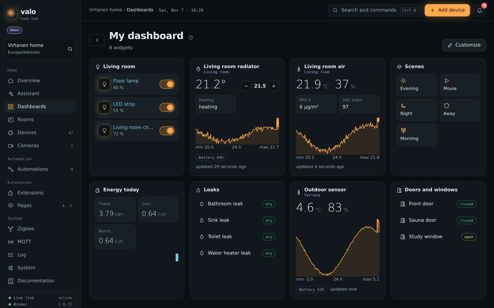

[Install](#install) · [Demo](#try-the-demo) · [Screenshots](#a-tour-of-valo) · [Valo and Home Assistant](#valo-and-home-assistant) · [Roadmap](#roadmap) · [FAQ](#faq) · [Contributing](#contributing)

## Why Valo

Home Assistant can do almost anything, and that is its strength. Valo is for people who want less: a hub that covers a typical Zigbee home with cameras very well, has one way to do each thing, and can be read and understood in an evening.

- **Local first.** Devices, automations, video and history stay in your home. Internet is needed only for extensions that fetch weather, energy prices or send Telegram messages, and for the assistant if you turn it on
- **One install.** A single script on a clean Ubuntu, or `docker compose up -d` with Docker. No configuration files, passwords are generated on the first start, the rest is set up in the browser
- **Zigbee first.** Zigbee2MQTT is built in, the setup wizard finds the USB coordinator and its firmware type by itself, the Zigbee page shows the network map, signal and firmware updates
- **Cameras included.** Live video in the browser, clips on motion and on automation events, continuous recording with a timeline, pan and tilt with presets, detection of people, cars and animals in zones, all without a separate NVR
- **Built for power cuts.** Every service restarts by itself, cameras that got a new address are found again, extensions reconnect, the database is backed up every day
- **Safe extensions.** Extensions run as separate processes with memory and CPU limits and get only the permissions they ask for and you grant
- **Seven languages.** English, Ukrainian, Russian, German, French, Spanish and Japanese

## A tour of Valo

The screenshots come from the built-in demo, which simulates a Finnish family home with 47 devices, two cameras, scenes and automations.

### Overview and floor plan

The home at a glance: rooms on a floor plan with temperature and devices, warnings that need attention, scenes, climate and energy.

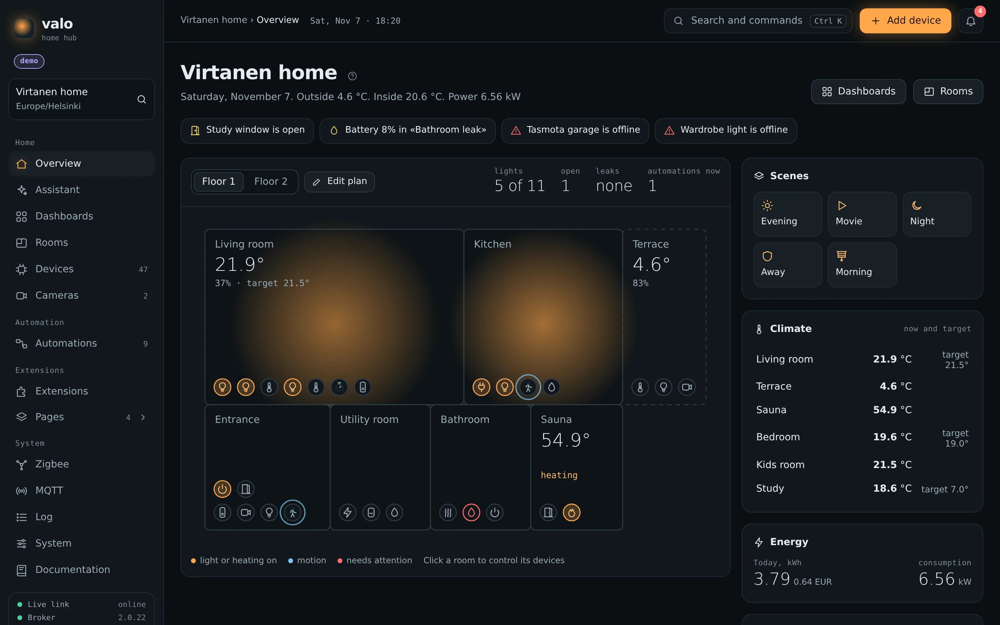

### Dashboards

Boards of widgets for the whole home, a room or a wall tablet. Widgets show the main value large and the history as a chart, control lights and plugs, run scenes. Light and dark themes follow the system.

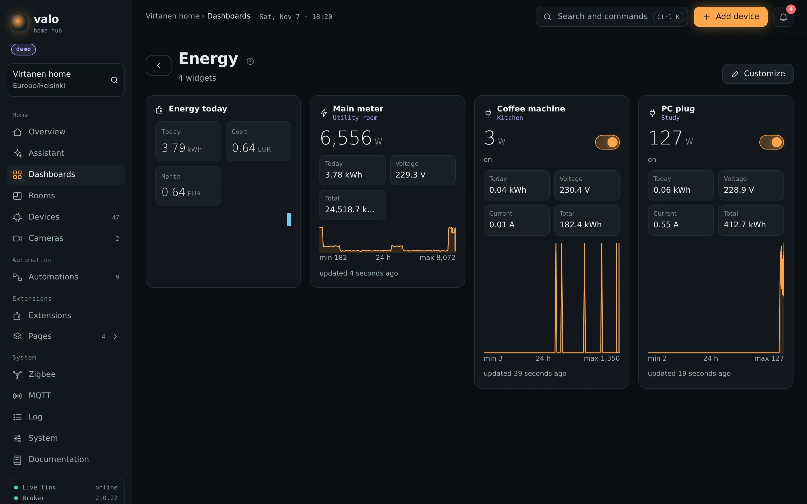

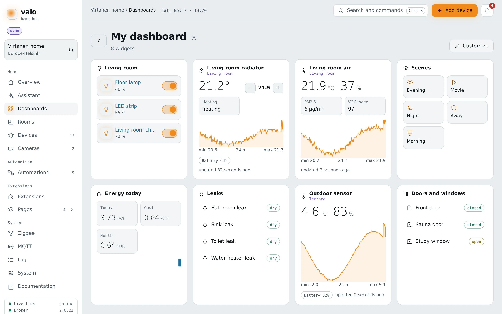

### Automations

A visual flow editor: triggers (state change, threshold, schedule, sun, MQTT message, camera event and blocks from extensions), conditions, waits, commands, scenes and notifications. Every automation has versions, a dry test run and a run history that shows the path each event took.

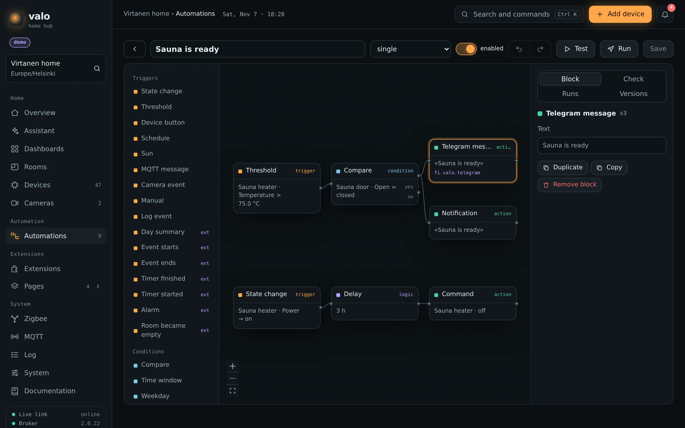

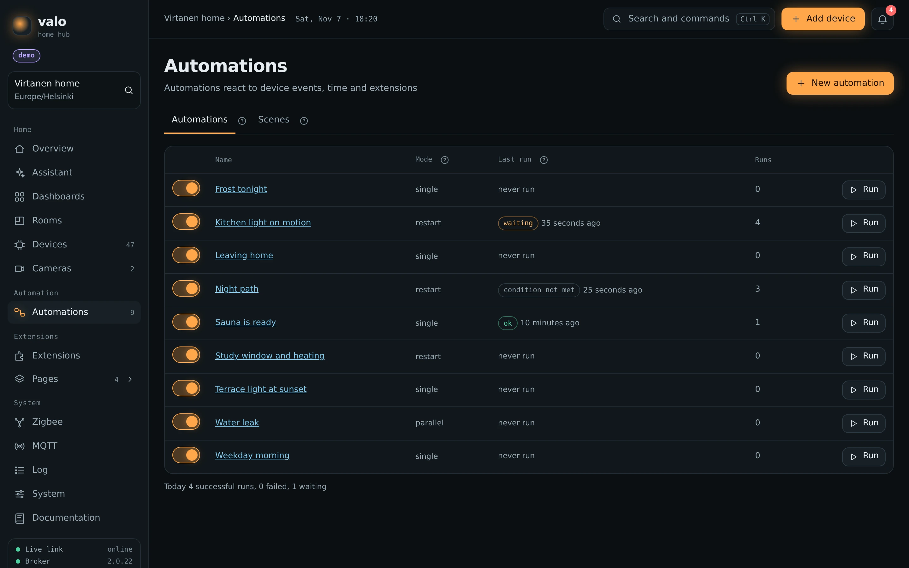

### Cameras

Valo records and plays video by itself, there is no separate NVR to set up. Cameras with [Thingino](https://thingino.com) firmware get full control (image settings, night mode, motion detection, pan and tilt, reboot, time sync), any other camera works over RTSP.

- live video with sound through WebRTC or MSE in any browser
- clips on motion with seconds before and after the event, snapshots, clips started from automations
- continuous recording by schedule with a timeline, retention by days and storage limits
- object detection on the CPU (people, cars, animals) with zones, used as a trigger in automations
- recordings by day, selection, download as an archive, protection from rotation

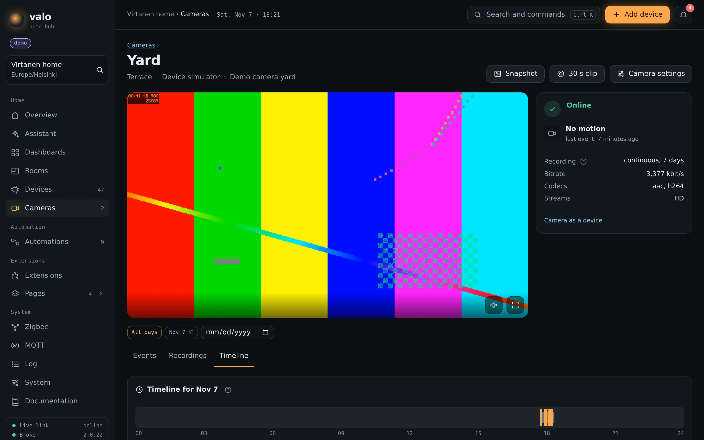

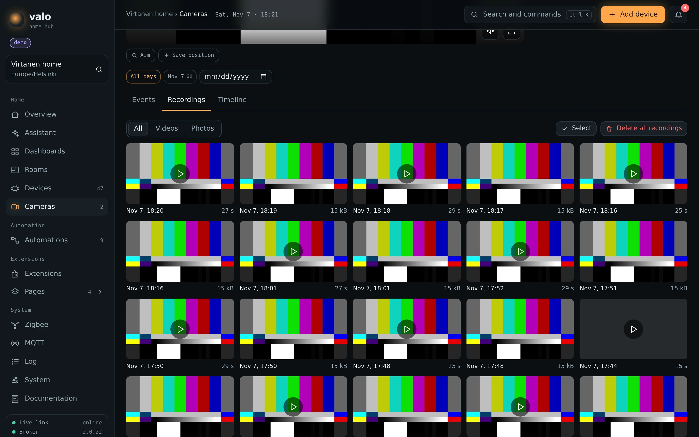

The demo cameras show a test picture from a simulator, real cameras show real video.

### Devices, Zigbee and MQTT

Every device in one list with its room, state, battery and signal. A device page shows its controls and the history of every reading. Zigbee devices come through Zigbee2MQTT, MQTT devices through Home Assistant MQTT discovery (Tasmota, ESPHome and others) or through manual topic mapping.

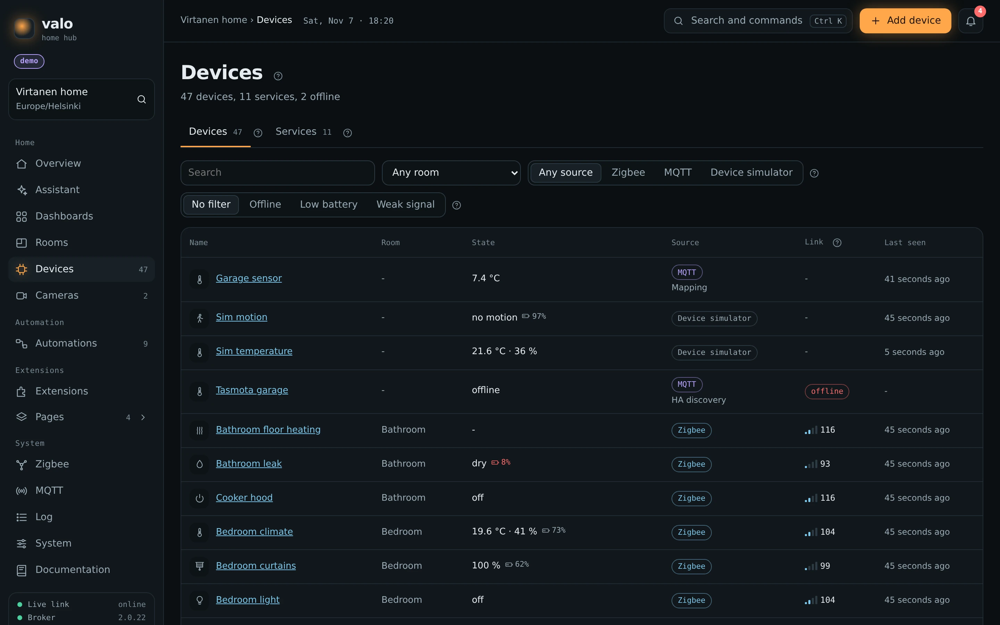

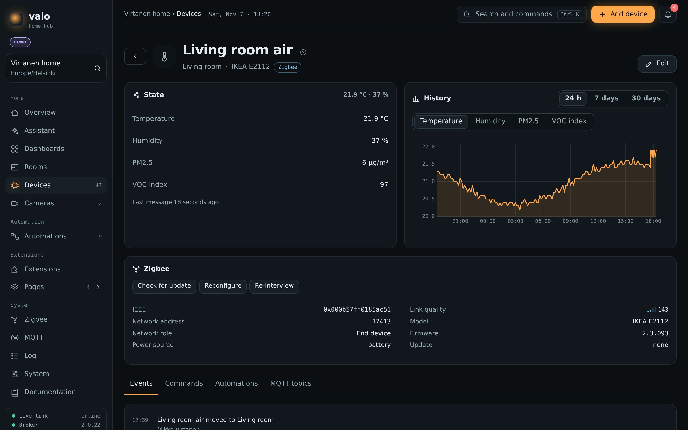

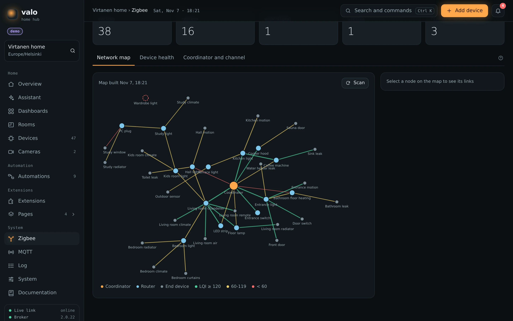

### Extensions

A catalog of official and community extensions: Telegram notifications with buttons, weather from Open-Meteo and the Finnish Meteorological Institute, energy usage and cost per plug, calendar and workdays, alarms and timers, room presence, home safety, plug guard and more. Extensions add devices, automation blocks, pages, dashboard widgets and camera drivers, and are written in Python with a small SDK.

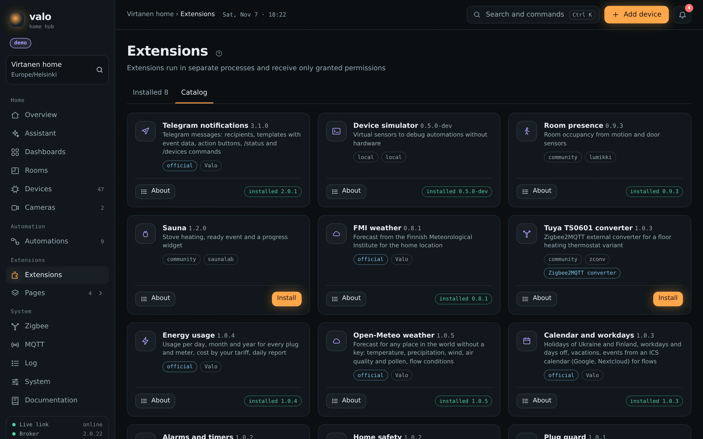

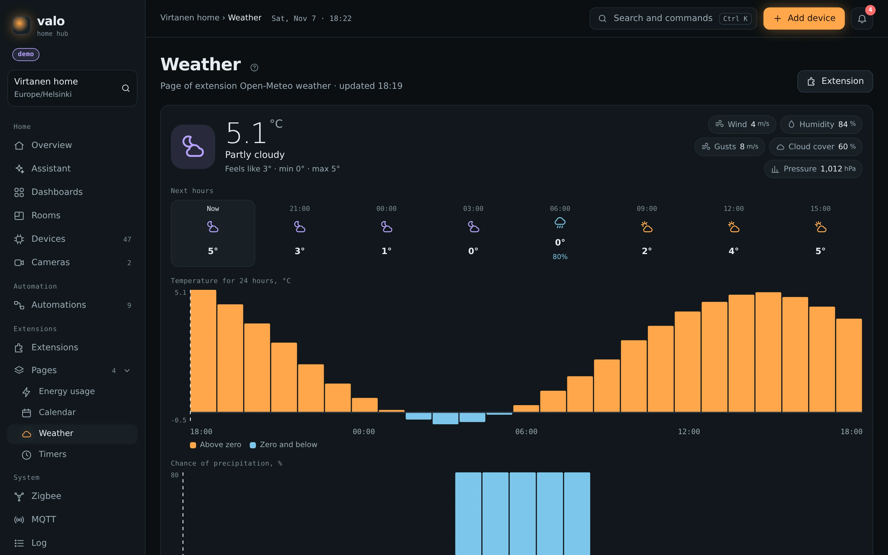

### Assistant

An optional chat with a language model that knows your home and the documentation. It answers questions about the home, builds dashboards and sets up rooms, always with your own rights. It works with OpenRouter or any compatible API, the key is stored encrypted. In the demo it runs on a built-in demo model without a key.

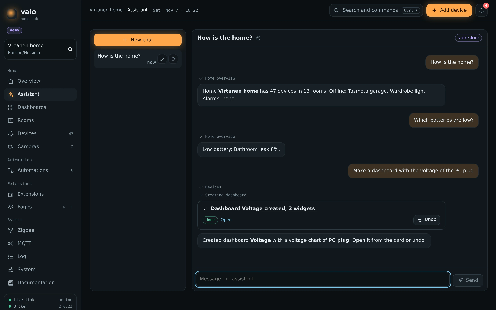

### Setup wizard

After the install the browser opens a short wizard: the home and its location, the broker and the Zigbee coordinator, the owner account.

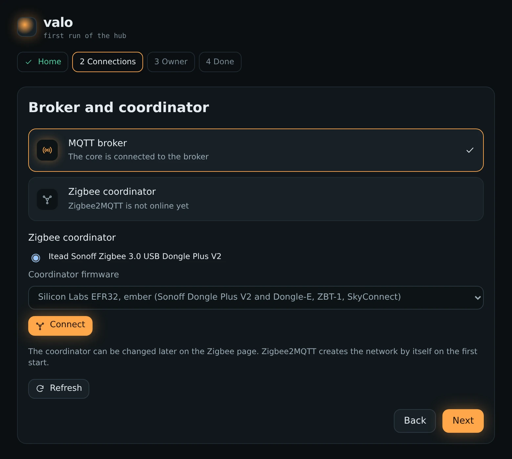

### On the phone

The web interface is made for phones as well as for wall tablets and computers.

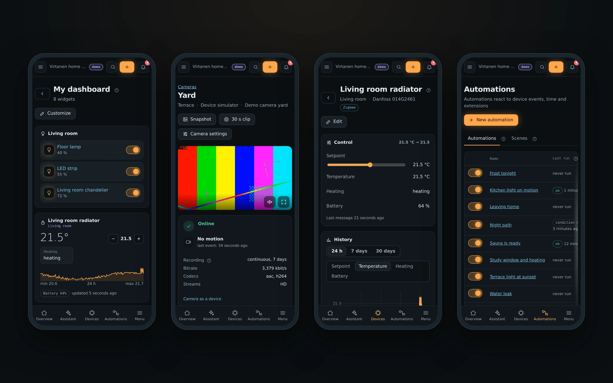

## Install

On a clean Ubuntu or Debian computer

```
curl -fsSL https://raw.githubusercontent.com/valo-home/valo/main/install.sh | sudo bash
```

The script installs Docker Engine from the official Docker repository, puts Valo into `/opt/valo`, starts it and prints the address, for example `http://192.168.1.20`. Open it in a browser and the setup wizard does the rest. Running the same command again updates Valo.

With Docker already installed

```
git clone https://github.com/valo-home/valo.git
cd valo
docker compose up -d
```

No configuration file is needed. Images for amd64 and arm64 are pulled from `ghcr.io/valo-home`, database migrations run on every start. Settings, updates, HTTPS and troubleshooting are in the [operations guide](ops/operations.md).

### Hardware

- any computer that stays on: a mini PC, an old laptop or a server, x86_64 or arm64
- 4 GB RAM or more, 8 GB with cameras and object detection. Valo uses about 1.7 GB when idle
- a Zigbee USB coordinator, for example Sonoff Zigbee 3.0 USB Dongle Plus V2 (ember), Sonoff Dongle-P (zstack) or ConBee II (deconz)
- optional IP cameras: Sonoff CAM Slim Gen2 and CAM-PT2 with Thingino firmware are tested, any RTSP camera works

## Try the demo

The demo runs the whole system with simulated Zigbee devices, cameras and ten days of history, no hardware needed

```
git clone https://github.com/valo-home/valo.git
cd valo
MOCKS_LANG=en ./valo demo up
```

Open http://localhost:3000 and sign in as `mikko` with the password `valo-demo`.

## Valo and Home Assistant

Valo is not a fork of Home Assistant and is not affiliated with it. It is a separate project with a narrower scope. An honest comparison

| | Valo | Home Assistant |
| --- | --- | --- |
| Devices | Zigbee through Zigbee2MQTT, MQTT devices with Home Assistant discovery, IP cameras, devices from extensions | thousands of integrations for almost any device and service |
| Install | one script or `docker compose up -d`, then a wizard in the browser | Home Assistant OS, container and other install types, add-ons |
| Cameras | recording on events and continuous, timeline, pan and tilt, object detection built in | camera integrations, recording and detection usually through add-ons such as Frigate |
| Automations | one visual flow editor with versions, test runs and run history | UI editor, YAML, blueprints and scripts |
| Extensions | Python processes with permissions and resource limits | custom integrations inside the core, add-ons as containers |
| Mobile | responsive web interface, app planned | official apps for Android and iOS |
| Maturity | early development, one developer, no releases yet | mature and stable, large community |

Choose Home Assistant if you need a wide range of integrations or a stable system today. Choose Valo if your home is mostly Zigbee and cameras, and you want a compact hub that does this well and stays simple.

## Roadmap

Before the first beta
- tagged releases and an update channel
- install of community extensions straight from their repositories
- a separate system user for extension processes
- longer runs on real hardware, fixes from them

After that
- the mobile app, see [valo-home/app](https://github.com/valo-home/app)
- hardware acceleration of object detection
- backups to external storage
- more camera drivers

## Architecture

Python 3.14 and Litestar for the core, SvelteKit and Svelte 5 for the web interface, PostgreSQL, Redis, RabbitMQ, Mosquitto with dynamic security, Zigbee2MQTT, go2rtc and FFmpeg for video, ONNX Runtime for detection, Caddy as the single entry point, all in Docker Compose.

| Folder | Content |
| --- | --- |
| `backend` | core: REST API, Socket.IO, MQTT ingest, extension supervisor, video service, flows, assistant, migrations, tests |
| `web` | web interface |
| `extensions` | extension SDK, catalog and official extensions |
| `mocks` | simulated Zigbee2MQTT and the demo home |
| `docs` | user and developer documentation, shown inside Valo |
| `ops` | operations guide |
| `assets` | screenshots and images for this page |

## Extensions

Extensions are small Python programs that run as separate processes and talk to the core over MQTT. They can add devices, automation blocks, pages, dashboard widgets and camera drivers. Start from [valo-home/extension-template](https://github.com/valo-home/extension-template) and read the developer guide in the Documentation section of Valo.

## FAQ

**Is Valo a replacement for Home Assistant?** For a home built on Zigbee devices and IP cameras it can be. For everything else Home Assistant has far more integrations.

**Does it need the internet or a cloud account?** No. Everything runs locally. Internet is used only by extensions that need it (weather, prices, Telegram) and by the assistant if you configure it.

**Does it run on a Raspberry Pi?** Images are built for arm64, so a Raspberry Pi 4 or 5 with 4 GB or more should work. Regular testing is done on x86_64 mini PCs.

**Which Zigbee coordinators work?** Every adapter Zigbee2MQTT supports. The wizard detects Silicon Labs (ember), Texas Instruments (zstack) and ConBee (deconz) sticks by name.

**Can I move my devices from Home Assistant?** Zigbee devices pair again with the Valo coordinator. MQTT devices that use Home Assistant discovery appear in Valo by themselves.

**Is it ready for daily use?** Not yet for most people. See the status note at the top.

## Contributing

Issues, ideas and pull requests are welcome, see [CONTRIBUTING.md](CONTRIBUTING.md). Report security problems privately, see [SECURITY.md](SECURITY.md).

## License

Apache License 2.0, see [LICENSE](LICENSE). Third party components and their licenses are listed in [NOTICE](NOTICE). Home Assistant is a trademark of its respective owner and is mentioned here only for comparison.
